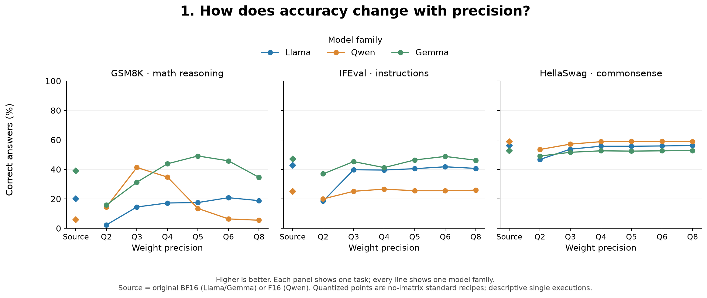
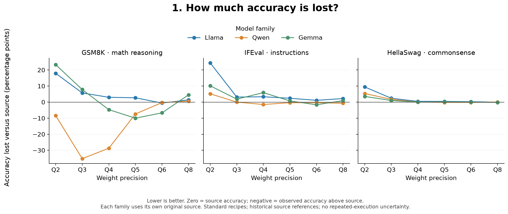
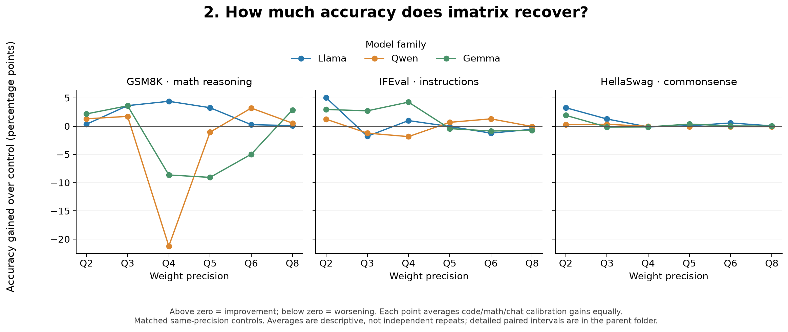
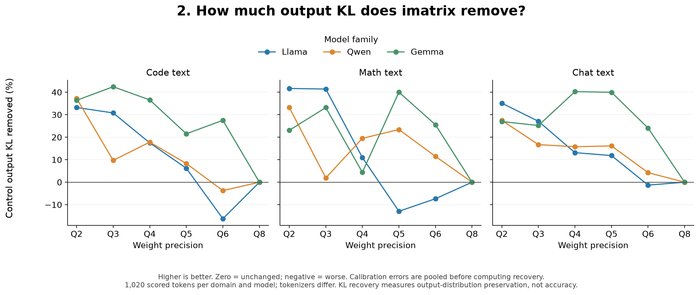
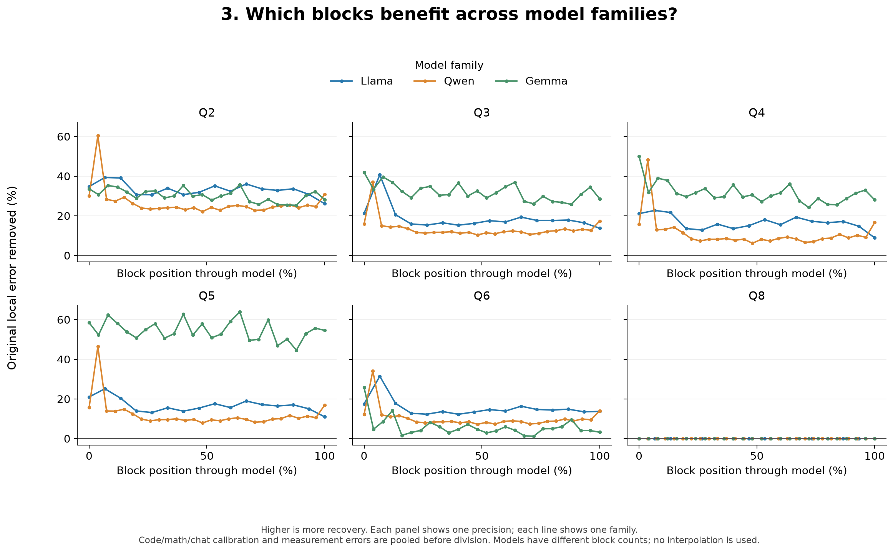
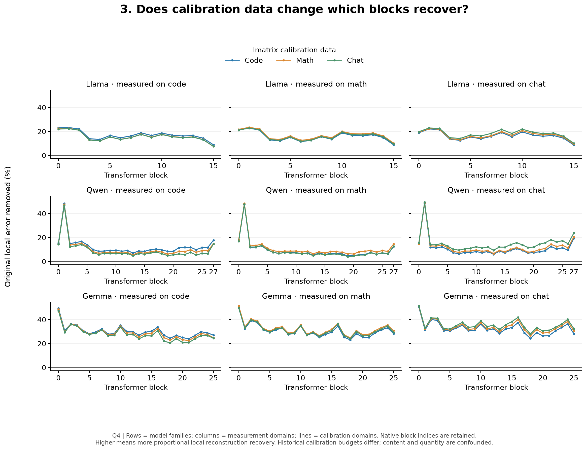

# Selected graphs and analysis

These six figures summarize the completed historical Llama, Qwen, and Gemma
experiments. Each graph measures one quantity. The [plotted CSVs and provenance
manifest](../results/research_questions/simple_comparisons/) accompany the figures;
[paired statistics](../results/research_questions/README.md) retain individual
calibration results and uncertainty.

## 1. Accuracy across precision and model families

Compare precision within each task and family. The original source is a separate
reference marker. Family differences also include checkpoint size, training, and
architecture differences; this is not an isolated architecture experiment.

## 2. Accuracy lost relative to each source

Zero means the source score; positive values mean accuracy lost in percentage
points. Negative values are observed scores above the historical source, which
do not establish superiority without repeated executions. These curves use
standard mixed-recipe controls, separate from the pure Llama precision sweep.

## 3. Imatrix accuracy gains against matched controls

Imatrix does not improve every family, precision, or task. Each point averages
code/math/chat calibration gains equally, so consult the individual paired
comparisons before choosing a calibration dataset. For example, Llama Q4 math
calibration gains 7.00 percentage points on GSM8K (pointwise paired 95% interval
4.00 to 10.10), whereas Qwen Q4 math calibration loses 21.00 points (interval
-24.40 to -17.70). Both pass Holm correction across all 162 comparisons.

## 4. Recovery of output distributions

Positive values mean lower KL divergence from the source than the matching
no-imatrix control; negative values mean worse divergence. Compare this plot
with benchmark gains: distribution preservation and task accuracy measure
different outcomes. Near-zero control KL can make percentage recovery unstable.

## 5. Local reconstruction recovery by block

Recovery varies across blocks, precisions, and families. Relative depth permits
an overview across different block counts, but does not align equivalent
computations. Local activation-weighted reconstruction is a diagonal
approximation; it does not measure end-to-end accuracy or establish which
blocks cause benchmark failures.

## 6. How calibration changes Q4 block recovery

Block-recovery rankings are similar across calibration choices. Mean pairwise
Spearman agreement is approximately 0.994 for Llama, 0.914 for Qwen, and 0.971
for Gemma. These descriptive correlations do not establish domain-specific
targeting. Historical calibration budgets differ, confounding data content
with quantity; blocks and measurement domains are related observations.

## Evidence and limits

The paired benchmark analysis uses 1,000 GSM8K, 541 IFEval, and 2,000 HellaSwag
questions per evaluated configuration. It checks matching question identities
and saved aggregate scores. Confidence intervals resample paired questions;
they do not include execution variability or independent calibration draws.
The equal-budget controlled Q4 study is unfinished and is excluded here.

The six overview graphs are descriptive; the supporting analysis applies global
Holm correction to 162 imatrix benchmark comparisons and preserves wins, losses,
ties, intervals, and adjusted p-values in `imatrix_task_effects.csv`.

Rebuild with `python -m src.research_questions` followed by
`python -m src.simple_research_plots`. Full regeneration requires the saved raw
experiment inputs listed in the manifests, including local files intentionally
excluded from Git. The committed CSVs preserve the plotted values for review.
