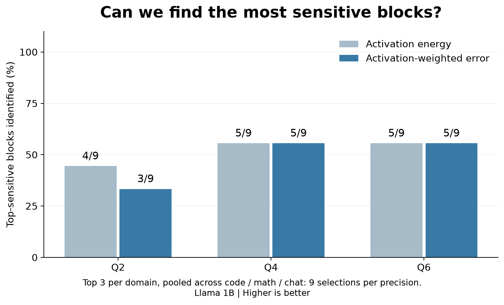
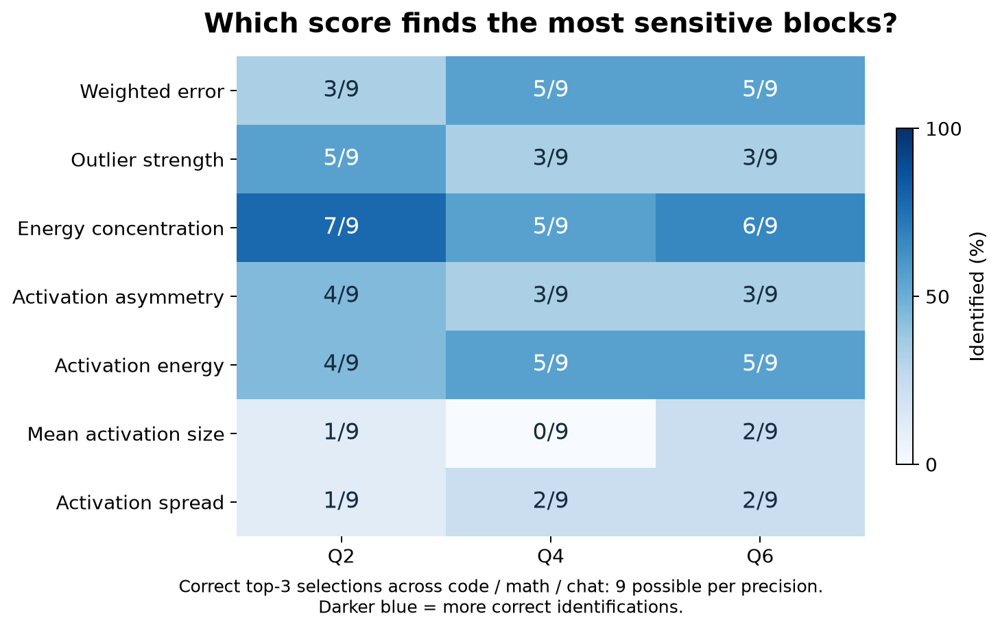
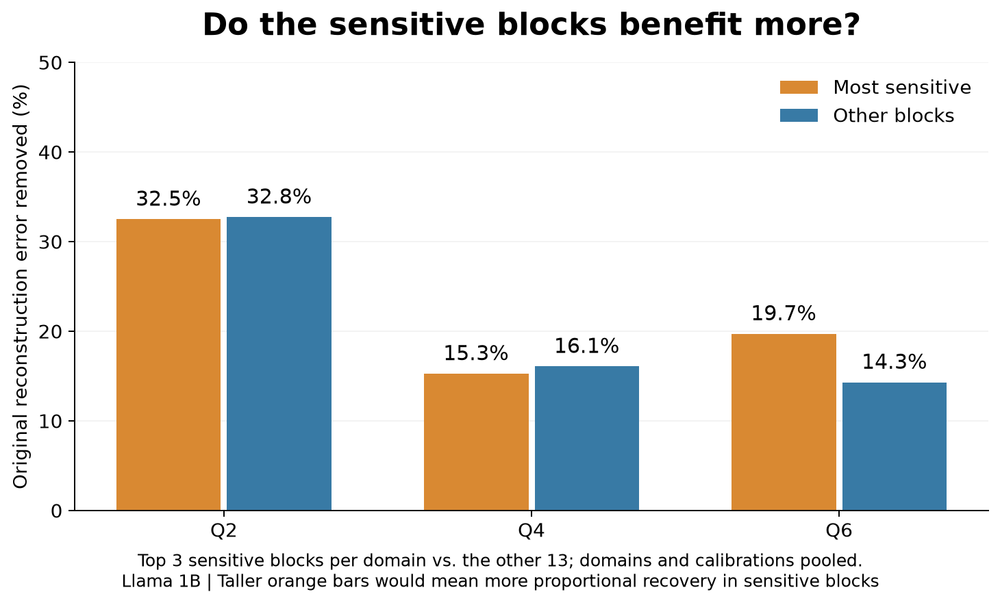
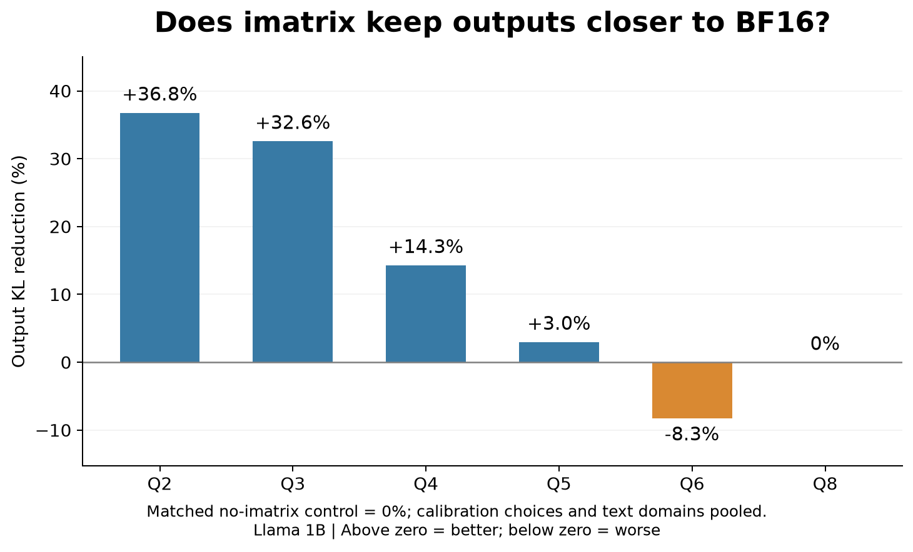
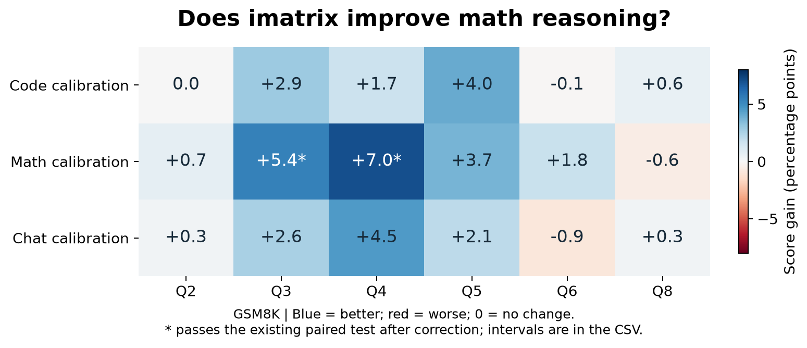
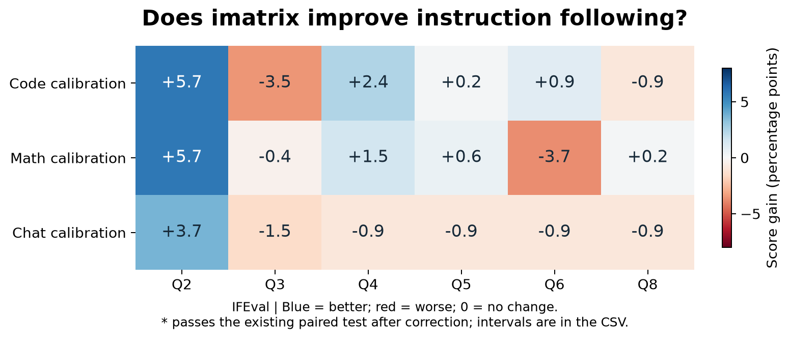
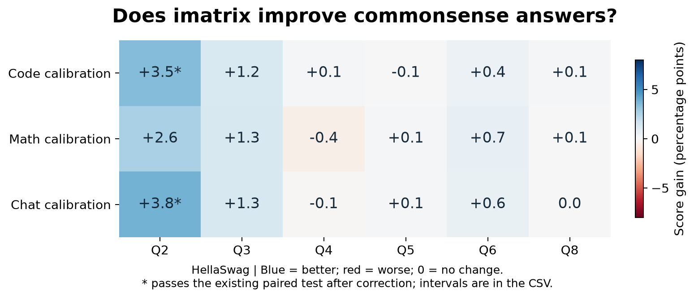

# Llama Quantization: Sensitivity Predictions and Imatrix Benefits

Each chart answers one question. All results use existing Llama-3.2-1B measurements.

## 1. Can we identify sensitive blocks?

Compare the predicted top 3 with Sneha's measured top 3 in each domain.
Nine selections = three blocks in each of code, math and chat; the same block can
appear in more than one domain. Higher is better. No method identifies every block.

### Can another statistic do better?

**Energy concentration (lower entropy) finds more top-sensitive blocks:** 18/27
selections versus 13/27 for weighted error. But weighted error still best matches
the full ordering of all 16 blocks. These are different goals.

See the [two-chart statistic comparison](questions/statistics/README.md) for full
rank agreement, definitions and checks. This is exploratory, not proof of a winner.

## 2. Do sensitive blocks benefit more?

Orange = the three most sensitive blocks in each domain; blue = the other thirteen.
Bars show the percentage of each group's original error removed. Taller orange
bars would support preferential recovery of sensitive blocks.

## 3. Does the model stay closer to BF16?

Above zero = closer to BF16. Below zero = farther away. This measures output
distributions, not task accuracy.

## 4. Does task performance improve?

Each number is the score change against the same-precision no-imatrix model,
in percentage points. Blue = better; red = worse. All three charts share one color
scale. A star marks a result passing the existing corrected paired test.

## What can we conclude?

Imatrix's predictions are imperfect. It improves local reconstruction broadly,
but does not consistently favor the most sensitive blocks. Output fidelity
improves most at low precision; task gains depend on precision and calibration.
Q6 can have better local reconstruction yet worse output KL. Q8 has unchanged
stored weights in the earlier audit, so its small score changes are not evidence
of an imatrix weight improvement.

## Scope and normalization

- **Block comparisons: Q2, Q4, Q6.** No block interventions are available at
  Q3/Q5/Q8. These comparisons cannot establish sensitivity there.
- **Whole-model results: Q2, Q3, Q4, Q5, Q6, Q8.** Controls use the same standard
  recipe and stored tensor layouts as the calibrated model at each precision.
- **Chart 1:** correct top-three identifications / nine domain-specific selections.
  Ties at the top-three boundary favor the lower block index. This is not full-rank
  agreement or a statistical significance test.
- **Chart 2:** 100 x summed error removed / summed control error. Pool three
  calibration choices and three measurement domains before division; select
  sensitive blocks separately for each precision/domain. Unequal group sizes
  are normalized to each group's own error, not to parameter count or file size.
- **Chart 3:** 100 x (1 - summed imatrix KL / summed control KL), pooling three
  calibrations and three domains. Each KL measurement scores 1,020 tokens.
- **Task charts:** raw percentage-point gains, not relative percent improvements.
  Paired confidence intervals and corrected p-values remain in
  [benchmark_gains.csv](questions/benchmark_gains.csv). Colors alone do not imply
  significance; the original correction covers 54 comparisons. Single executions
  do not establish run-to-run reliability.
- **Protocol mismatch:** sensitivity lowers one block in an otherwise-Q8 model;
  reconstruction and task gains come from whole-model standard recipes. The
  connection is exploratory. Intervention checkpoint/text/build hashes are not
  fully matched across machines. Calibration budgets differ: code/math/chat
  49/97/699 chunks of 512 tokens. Results cannot isolate domain from budget.

## Files

Use the six PNGs in [questions/](questions/) for presentation. Their source tables,
exact plotted values, paired uncertainty and provenance are in the same folder.
The additional feature comparison is in [questions/statistics/](questions/statistics/).

Redraw all eight published PNGs from the included tables (no model files needed):

`python results/final_analysis/build_question_charts.py --render-only`

Requires Python with numpy, pandas and matplotlib (included in the project requirements).

Recompute from the complete local experiment outputs:

`python results/final_analysis/build_question_charts.py`

The full recomputation requires the original raw sweep, imatrix exports and audit
inputs named in `questions/manifest.json`. Those large intermediate folders are
not bundled with this summary. The published CSVs preserve the measured values
used in the charts; hashes alone cannot reconstruct omitted source data.

No new model runs. PNG only.
