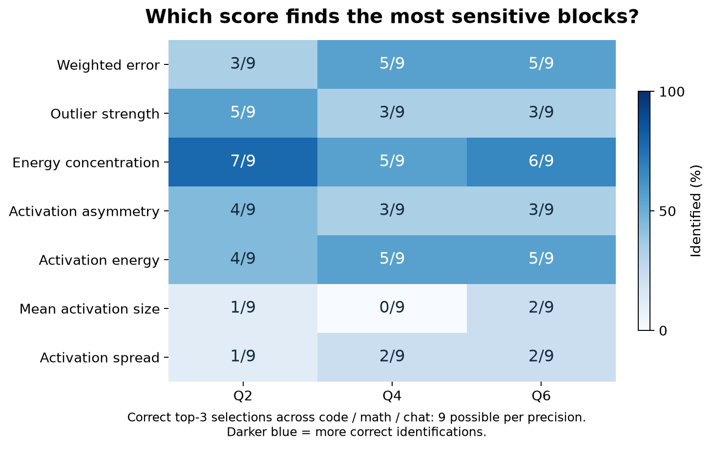
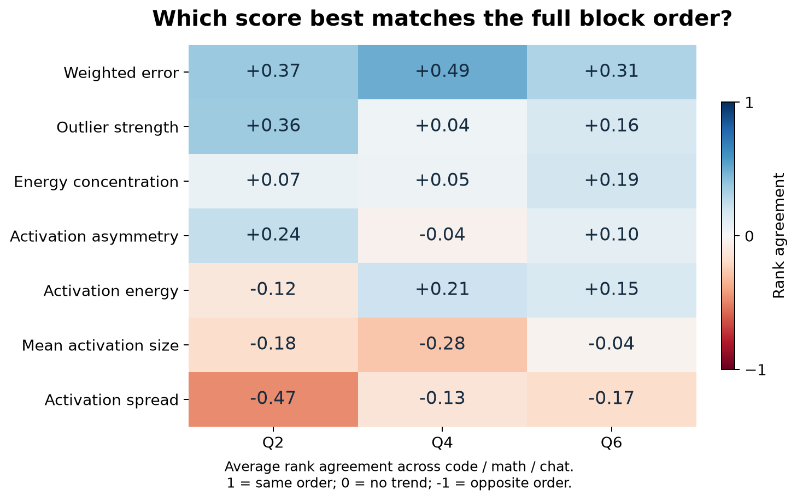

# Can other imatrix statistics predict sensitivity better?

**It depends on the goal.** Energy concentration identifies more of the top-three
sensitive blocks. Weighted error still best matches the full ordering of blocks.

## Find the critical blocks

Energy concentration identifies **18 of 27** domain-specific top-three selections,
compared with **13 of 27** for weighted error and **14 of 27** for activation energy.
These are repeated selections across nine precision/domain groups, not 27 unique blocks.

## Rank all 16 blocks

Weighted error has the strongest average agreement (**0.39**), followed by outlier
strength (**0.19**). Energy concentration averages **0.10**. No additional statistic
beats weighted error on full-order agreement averaged over the nine groups.

## What each score means

| Score | Definition |
| --- | --- |
| Weighted error | Existing precision-specific, reference-normalized Q-minus-Q8 local error |
| Activation energy | Sum of seven tensor energies |
| Energy concentration | Mean of 100 minus normalized energy entropy; lower entropy ranks higher |
| Outlier strength | Mean tensor excess kurtosis of dimension-wise mean activations |
| Activation asymmetry | Mean absolute tensor skewness of dimension-wise mean activations |
| Activation spread | Mean tensor standard deviation of dimension-wise mean activations |
| Mean activation size | Mean absolute tensor mean; not mean absolute per-token activation |

The added features use the BF16 model only. Mean/spread/skew/kurtosis describe the
distribution of dimension-wise **mean activations**, not the distribution of
individual token activations. Concentration uses **100 minus normalized energy
entropy**. It is an inverse-entropy score, not a new physical quantity.

Each block score is the equal mean of its seven tensor summaries, except energy
(sum) and weighted error (ratio of pooled errors to pooled reference energy).
Average tensor kurtosis or entropy is not a pooled block-distribution statistic.
Absolute mean and skew are taken per tensor before averaging. All directions
are fixed: larger values predict greater sensitivity. Signs are never flipped
after examining a precision or domain. Negative correlation means the chosen
direction fails, not that the statistic has been converted into a good predictor.

## Checks and interpretation limits

- Correlation means Spearman rank agreement, calculated within each 16-block
  precision/domain group. Summary values are equal arithmetic averages of signed
  correlations, not correlations over pooled raw measurements. Increasing rescaling
  does not change these correlations, so no arbitrary 0-100 feature scaling is needed.
- Top-three overlap is normalized by nine selections per precision. Ties at the
  boundary are resolved by lower block index; rank correlation uses average ties.
- Removing block 1 weakens mean agreement: weighted error falls to about **0.26**,
  outlier strength to **0.01**, and concentration to **-0.09**. Success on a few
  critical blocks does not imply a reliable full ranking.
- The primary charts screen seven complete scores on the existing data. Results are exploratory; choosing
  the best score here needs validation on new text or interventions. There are no
  p-values or claims that one score is statistically superior. Related domains and
  precisions are not independent trials. No regression was fitted to 16 blocks.
- Gain, L2 distance, Pearson and covariance compare a tensor with the corresponding
  tensor in a preceding block. They are present for blocks 1-15 but unavailable for
  block 0. The separate comparison below uses exactly the same 15 blocks for every
  predictor, rather than filling block 0 with a fabricated value. Signed raw
  mean/skew were not separately searched, nor were many alternative aggregations.
- Source summary values are rounded. Imatrix budgets differ across domains. Measured
  sensitivity uses one lowered block on a Q8 background; cross-machine provenance
  limitations from the main report still apply. No new model inference was run.

**Recommendation:** keep weighted error as the current full-ranking baseline and
energy concentration as a promising top-block selector. Do not claim that one
statistic is best for every purpose or precision.

Exact comparisons and outlier checks: `comparisons_by_domain.csv`,
`comparisons_by_precision.csv`, and `summary.csv`. Joined block features:
`feature_blocks.csv`. Definitions: `feature_definitions.csv`. Hashes: `manifest.json`.

Rebuild: `python results/final_analysis/build_statistic_comparison.py`.
Charts are PNG only.

## Additional check: neighboring-block statistics

These results exclude block 0 for **every** score. Weighted error still has the
strongest average full-ranking agreement (about 0.50). Neighbor activation
difference, distance and energy gain are promising alternatives, but none beats
that matched baseline. These numbers must not be directly compared with the
16-block chart above: the target set and its top three have changed.

| label | mean_rank_agreement | mean_rank_agreement_without_block1 | top3_hits |
| --- | --- | --- | --- |
| Weighted error | 0.497 | 0.382 | 16 |
| Neighbor activation difference (1 - Pearson) | 0.372 | 0.226 | 10 |
| Neighbor activation distance | 0.345 | 0.209 | 14 |
| Neighbor energy gain | 0.322 | 0.166 | 15 |
| Outlier strength | 0.163 | -0.030 | 11 |
| Activation energy | 0.143 | -0.055 | 14 |
| Activation asymmetry | 0.068 | -0.147 | 10 |
| Energy concentration | 0.037 | -0.185 | 14 |
| Mean activation size | -0.159 | -0.196 | 3 |
| Activation spread | -0.235 | -0.058 | 5 |
| Absolute neighbor covariance | -0.350 | -0.200 | 1 |

Gain is the ratio of current to preceding tensor RMS energy; L2 and Pearson
compare dimension-wise mean-activation vectors in the exported nonlegacy data.
We use 1 minus Pearson so larger means more neighbor difference, and absolute
covariance so sign does not cancel across tensors. All are equal means of seven
tensor summaries. These transformations are fixed for every domain and precision.
The local llama.cpp statistic implementation and existing repository explanations
were inspected to distinguish neighbor comparisons from quantized-versus-BF16 drift.

See `neighbor_comparisons_15_blocks.csv` and `neighbor_summary_15_blocks.csv`.
Across primary and supplemental checks, 11 distinct scores were screened; this
remains an exploratory comparison on the same measured sensitivity data.
