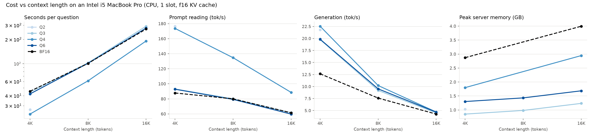

# Context length × weight quantization: interim findings (Llama-3.2-1B)

**Status: Nights 1–2 of 5. 25 of 26 RULER runs are done.**

- The one run still to do is Q3 on `ruler_vt` at 16K. It was stopped partway and resumes with Night 2.
- Not run yet: padded GSM8K (Night 3), long-context KL and `niah_single_1` (Night 4), and 32K (Night 5).
- Every number here comes from 20 questions per cell, so treat the trends as provisional.

Regenerate the tables and figures with `python -m rohan.analyze_long_context`.

## Question

Does damage from weight quantization grow with context length? And what does each length and level cost on a CPU?

The teammates' task15 fixed the weights at mixed Q2_K and varied the KV-cache type. This study does the opposite:

- **Weights:** varied (BF16 and pure Q2/Q3/Q4/Q6).
- **KV cache:** fixed at f16.

## Setup

| | |
|---|---|
| Model | Llama-3.2-1B-Instruct GGUF. BF16 and pure k-quants, the same files as `results/Llama_Pure_Sweep/` |
| Tasks | Two RULER tasks from lm-eval 0.4.13, sized with Llama's own tokenizer: • `niah_multikey_2`: find one key's value among many similar keys • `ruler_vt`: multi-hop variable tracking, partial credit per variable |
| Lengths | 4K, 8K and 16K tokens |
| Questions | 20 per cell, with identical questions at every level, so gaps are paired |
| Hardware | 2020 Intel MacBook Pro, 16 GB RAM. llama-server on CPU, 1 slot, flash attention, f16 KV cache |
| Compute so far | About 16 h (BF16 4.6 h, Q6 4.7 h, Q3 3.3 h, Q4 3.1 h, Q2 0.3 h) |

## Accuracy (%, ±1 standard error)

| Task | Level | 4K | 8K | 16K |
|---|---|---|---|---|
| niah_multikey_2 | BF16 | 100 ± 0 | 70 ± 11 | 70 ± 11 |
| | Q6 | 100 ± 0 | 70 ± 11 | 70 ± 11 |
| | Q4 | 95 ± 5 | 60 ± 11 | 55 ± 11 |
| | Q3 | 75 ± 10 | 75 ± 10 | 40 ± 11 |
| | Q2 | 0 | — | — |
| ruler_vt | BF16 | 82 ± 3 | 78 ± 5 | 64 ± 4 |
| | Q6 | 81 ± 3 | 78 ± 4 | 66 ± 5 |
| | Q4 | 69 ± 3 | 74 ± 4 | 65 ± 4 |
| | Q3 | 34 ± 6 | 36 ± 5 | *pending* |
| | Q2 | 0 | — | — |

*On niah_multikey_2, Q6 has the same per-question scores as BF16, so its line is hidden under BF16's.*

## Gap to BF16 (points, paired over the same questions)

| Task | Level | 4K | 8K | 16K |
|---|---|---|---|---|
| niah_multikey_2 | Q6 | 0 | 0 | 0 |
| | Q4 | −5 ± 5 | −10 ± 10 | −15 ± 8 |
| | Q3 | −25 ± 10 | +5 ± 14 | −30 ± 13 |
| ruler_vt | Q6 | −1 ± 1 | 0 ± 4 | +2 ± 4 |
| | Q4 | −13 ± 4 | −4 ± 6 | +1 ± 5 |
| | Q3 | −48 ± 7 | −42 ± 6 | *pending* |

## What the results say so far

1. **Length hurts more than moderate quantization.**
   - BF16 itself drops 30 points on `niah_multikey_2` (100% to 70%) and 18 points on `ruler_vt` (82% to 64%) between 4K and 16K.
   - Q4's largest gap at any length is 15 points, and Q6's is zero.

2. **Q6 is effectively lossless at long context.**
   - On `niah_multikey_2`, Q6 gives the same answers as BF16 on every question at every length.
   - On `ruler_vt`, it stays within 2 points.
   - This matches the short-context pure sweep, where Q6's KL was near zero.

3. **Q2 fails completely, regardless of length.**
   - It scores 0% on both tasks even at 4K.
   - Its output is degenerate loops ("One of the same 8 / One of the same 8 / …"). This matches the pure sweep's KL of about 6.7 for pure Q2_K.
   - Larger lengths weren't run, since there is no accuracy left to lose.

4. **Whether Q4 and Q3 lose more at longer context depends on the task.** The evidence is weak so far.
   - **Retrieval with distractors (`niah_multikey_2`):** Q4's gap widens steadily, from −5 to −10 to −15 points. Q3 is at −30 points by 16K. This is the pattern the hypothesis predicts. But each step is within about one standard error, and Q3's 8K point (+5) breaks the trend.
   - **Multi-hop tracking (`ruler_vt`):** the gaps shrink instead. Q4 goes from −13 points at 4K to +1 at 16K. Q3 sits flat around −45 points. Part of the reason is that BF16 itself declines toward the quantized models' level by 16K.
   - The Night 4–5 runs (`niah_single_1` for every level, 32K) and the KL-vs-window measurements, which have no sampling noise, should settle this.

5. **Q3's vt damage is a fixed loss, not one that grows with length.**
   - Q3 loses about half of vt accuracy at both 4K and 8K.
   - That points to weaker multi-step reasoning in general, not trouble with long context.

## Cost on this CPU

| Level | Seconds/question (4K / 8K / 16K) | Prompt reading (tok/s, 4K → 16K) | Generation (tok/s, 4K → 16K) | Peak memory, 4K → 16K (GB) | File (GB) |
|---|---|---|---|---|---|
| BF16 | 45 / 101 / 269 | 88 → 62 | 12.6 → 4.3 | 2.9 → 4.0 † | 2.31 |
| Q6 | 42 / 101 / 276 | 93 → 60 | 19.8 → 4.7 | 1.30 → 1.68 | 0.95 |
| Q4 | 24 / 61 / 191 | 174 → 89 | 22.5 → 4.7 | 1.8 → 3.0 † | 0.65 |
| Q3 | 44 / 102 / 292 | 93 → 62 | 19.8 → 4.5 | 0.85 → 1.23 | 0.50 |
| Q2 | 27 / — / — | 177 | 21.8 | 1.02 | 0.39 |

- **Time grows faster than length.** Going from 4K to 16K (4× the tokens) costs 4.5–6.5× more time per question.
  - Prompt reading slows by 30–50% at 16K.
  - Generation drops to about 4.5 tok/s for every level, because each new token attends over the whole context.
- **Speed tracks the quant format, not the bit count.**
  - Q4_K_M and Q2_K read prompts about 2× faster than Q3_K_M, Q6_K and BF16.
  - Q3 is no faster than BF16. Generation is memory-bound at short context, so every quant beats BF16 there. At 16K, attention dominates and the advantage disappears.
- **Q4 is the speed sweet spot.** It is the fastest level at every length, and its accuracy is within 15 points of BF16.
- **Memory grows with length,** by about 0.4 GB from 4K to 16K for Q6 and Q3, which is mostly the KV cache (144 to 528 MiB).
- **Q4 and Q2 use more memory after loading than their file size** (Q4: 1.5 GB vs 0.65 GB). A likely, unverified explanation is llama.cpp's CPU weight repacking for these formats, which would also explain why they're fast.

† **Memory caveat:** Night 1 (BF16 and Q4) ran with llama-server's default 8 GB RAM prompt cache. That cache kept every past prompt and inflated peak memory by about 2 GB, so those runs are excluded from memory figures.
- BF16 and Q4 memory comes from the pilot, at 4K and 16K only. The pilot also had the cache on, but with just 3 prompts, so the inflation was small (about 0.3 GB).
- From Night 2 on, the server runs with `--cache-ram 0`.
- Night 1's accuracy and speed are unaffected, since RULER prompts share almost nothing.

## Caveats

- 20 questions per cell gives a standard error of about 11 points on `niah_multikey_2`, where every answer is right or wrong. Only gaps of about 20 points or more are clear on their own.
- RULER fills 89–94% of the 4K window and 96–99% of 16K, by design (it leaves room for the answer).
- All timings come from one machine with background apps closed but not otherwise controlled.

## Files

| File | Contents |
|---|---|
| `summary_long_context.csv` | One row per run: accuracy, SE, time, speed, memory, the `cache_ram_on` flag |
| `ruler_accuracy_table.csv` | The accuracy table above |
| `quant_gap_vs_bf16.csv` | Paired gaps and their standard errors |
| `../<run>/stats.json`, `metrics.json`, `samples.json`, `server.log` | Raw per-run outputs |

## Still to come

| Night | Adds |
|---|---|
| 2 (rest) | Q3 `ruler_vt` 16K |
| 3 | GSM8K behind 4K/16K of padding for BF16, Q8, Q6, Q4, Q3. Padding 0 is the pure sweep |
| 4 | KL vs BF16 at 4K/8K/16K windows for every level; `niah_single_1` at 4K for every level plus task15's mixed Q2_K; 16K for Q2 and mixed Q2_K |
| 5 | `niah_single_1` 16K for BF16/Q4; `niah_multikey_2` at 32K for BF16/Q4 |
| Later | Clean memory rerun for BF16 and Q4 at 8K; needle-depth breakdown |
