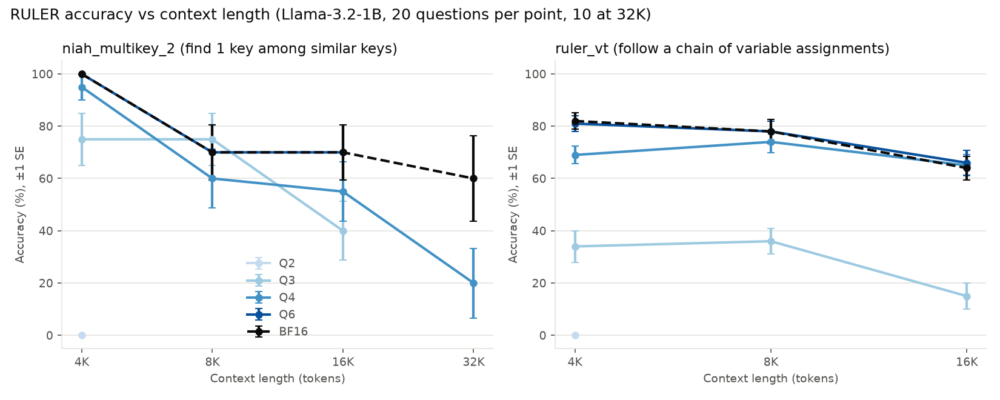
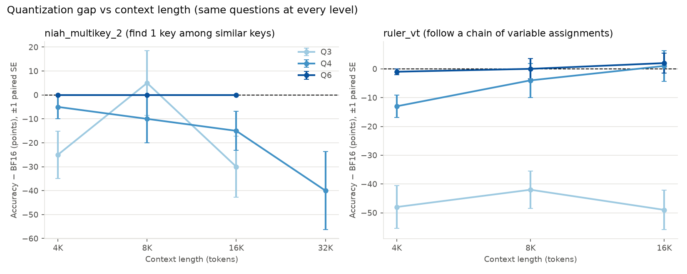
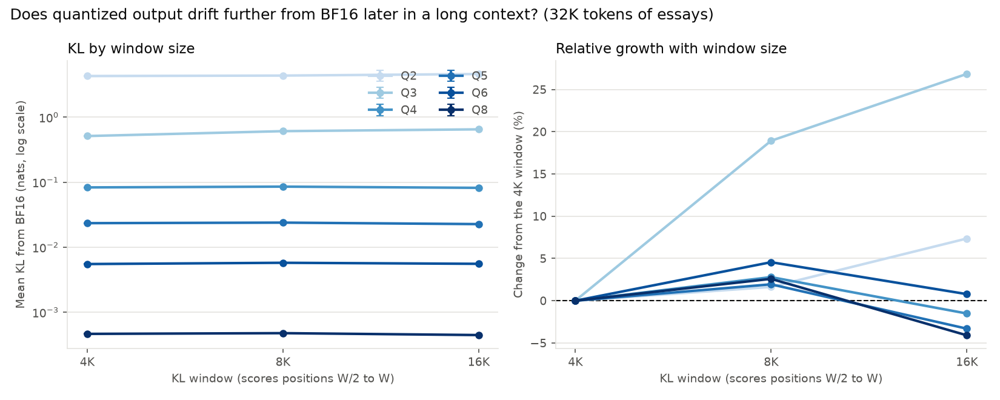
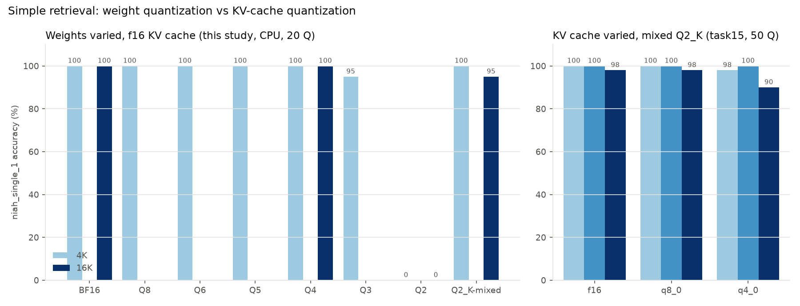
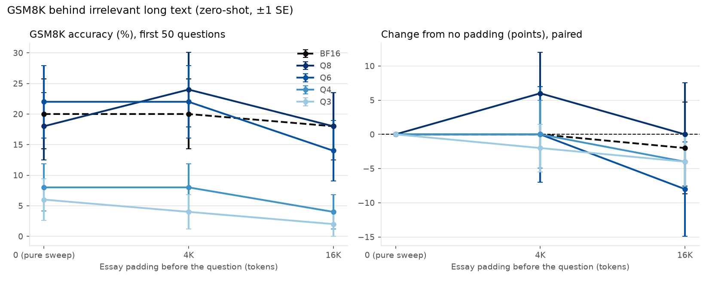
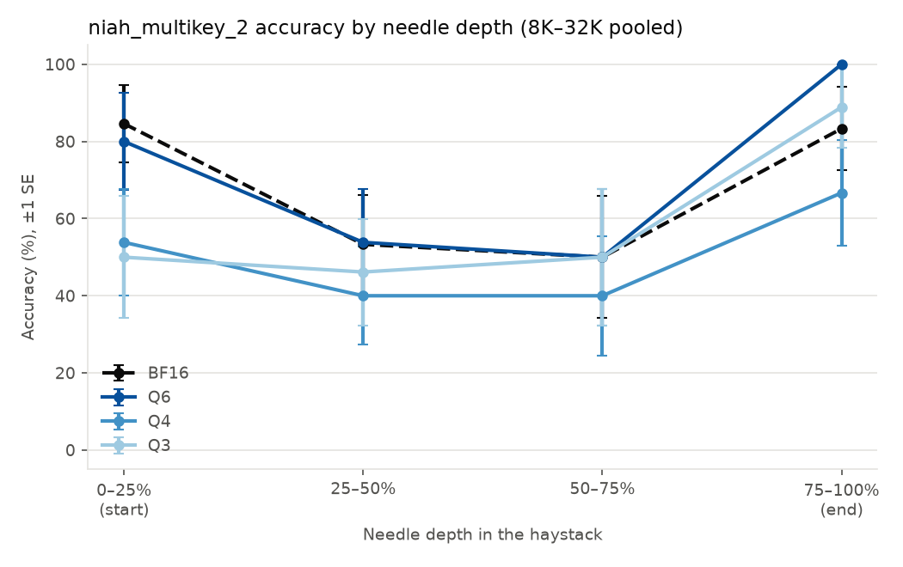
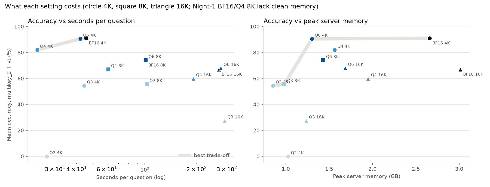

# Context length × weight quantization: findings (Llama-3.2-1B)

**Status: complete.** All 69 planned runs finished over five nights, with no failures, using about 36 hours of CPU time.

Regenerate every table and figure here with `python -m rohan.analyze_long_context`.

## Summary

1. **Context length hurts more than moderate quantization.**
   - Even BF16 falls from 100% to 60% on `niah_multikey_2` between 4K and 32K.
   - Q6, Q5 and Q8 track BF16 almost exactly at every length.
2. **Pure Q2 is broken at any length, and mixed Q2_K is not.**
   - Pure Q2 scores 0% on every RULER task, even simple retrieval at 4K.
   - The mixed-recipe Q2_K model that task15 used scores 100% at 4K and 95% at 16K.
   - The quantization recipe matters more than the nominal bit width.
3. **Damage that grows with length shows up only at Q4 and below, and only on some tasks.**
   - On retrieval among distractors, Q4's gap to BF16 widens with length: −5, −10, −15, then −40 points at 32K.
   - KL from BF16 grows with position for Q3 (+27% from the 4K to the 16K window) and Q2 (+7%). It stays flat for Q4–Q8.
   - Multi-hop tracking and simple retrieval show no widening.
4. **Q3 has a large fixed loss** on multi-step tasks: about −45 points on variable tracking at every length, and the biggest drop on padded GSM8K (−9 points).
5. **Simple retrieval tolerates both kinds of quantization.**
   - Quantizing the weights down to Q4 keeps `niah_single_1` at 100% through 16K.
   - Task15's q4_0 KV cache drops it to 90% at 16K.
   - Our f16-cache run of task15's exact model reproduces their result on this CPU: 100% and 95%, against their 100% and 98%.
6. **Cost on this CPU.**
   - **Q4 is the fastest level,** about 2× faster prompt reading than the others.
   - **Q6 matches BF16's accuracy with half the memory,** but runs at the same speed.
   - **Each question takes 4.5–6.5× longer at 16K than at 4K,** and 10–13 minutes at 32K.

## Question and design

Does damage from weight quantization grow with context length? And what does each length and quant level cost on a CPU?

The teammates' task15 (`results/task15_long_context_results/`) did the opposite:

| | Task15 | This study |
|---|---|---|
| Weights | Fixed at mixed Q2_K | Varied: BF16 and pure Q2–Q8, plus mixed Q2_K as a link to task15 |
| KV cache | Varied: f16, q8_0, q4_0 | Fixed at f16 |
| Hardware | Apple-silicon GPU | 2020 Intel MacBook Pro, 16 GB RAM, CPU only |
| Prompt sizing | Qwen3 tokenizer | Llama's own tokenizer |

| Experiment | What | Grid |
|---|---|---|
| **E1 KL** | KL from BF16 with 4K, 8K and 16K windows over the same 32K tokens of essays. Window W scores positions W/2 to W of each chunk, so larger windows measure later positions | Q2–Q8, plus BF16 vs itself (KL 0.0000, so the measurement is sound) |
| **E2 RULER** | `niah_multikey_2` (find one key among many similar keys) and `ruler_vt` (multi-hop variable tracking, partial credit) | {BF16, Q6, Q4, Q3} × 4K/8K/16K, plus Q2 at 4K; 20 questions each, the same questions at every level |
| **E2b niah_single_1** | Simple retrieval, and a direct comparison with task15 | Every level plus mixed Q2_K at 4K; {BF16, Q4, Q2, mixed Q2_K} at 16K; 20 questions |
| **E3 padded GSM8K** | The pure sweep's zero-shot GSM8K prompt behind 4K or 16K tokens of unrelated essays | {BF16, Q8, Q6, Q4, Q3}; 100 questions at 4K, 50 at 16K. Padding 0 is `Llama_Pure_Sweep` |
| **E4 32K** | Does the trend continue past 16K? | `niah_multikey_2`, {BF16, Q4}, 10 questions |

All runs: llama-server on CPU, 1 slot, flash attention, f16 KV cache, greedy decoding.

## E2/E4: RULER accuracy

Accuracy (%, ±1 standard error):

| Task | Level | 4K | 8K | 16K | 32K |
|---|---|---|---|---|---|
| niah_multikey_2 | BF16 | 100 ± 0 | 70 ± 11 | 70 ± 11 | 60 ± 16 |
| | Q6 | 100 ± 0 | 70 ± 11 | 70 ± 11 | |
| | Q4 | 95 ± 5 | 60 ± 11 | 55 ± 11 | 20 ± 13 |
| | Q3 | 75 ± 10 | 75 ± 10 | 40 ± 11 | |
| | Q2 | 0 | | | |
| ruler_vt | BF16 | 82 ± 3 | 78 ± 5 | 64 ± 4 | |
| | Q6 | 81 ± 3 | 78 ± 4 | 66 ± 5 | |
| | Q4 | 69 ± 3 | 74 ± 4 | 65 ± 4 | |
| | Q3 | 34 ± 6 | 36 ± 5 | 15 ± 5 | |
| | Q2 | 0 | | | |

*On niah_multikey_2, Q6 gives the same answer as BF16 on every question, so its line is hidden under BF16's.*

Gap to BF16 (points, paired over the same questions):

| Task | Level | 4K | 8K | 16K | 32K |
|---|---|---|---|---|---|
| niah_multikey_2 | Q6 | 0 | 0 | 0 | |
| | Q4 | −5 ± 5 | −10 ± 10 | −15 ± 8 | **−40 ± 16** |
| | Q3 | −25 ± 10 | +5 ± 14 | −30 ± 13 | |
| ruler_vt | Q6 | −1 ± 1 | 0 ± 4 | +2 ± 4 | |
| | Q4 | −13 ± 4 | −4 ± 6 | +1 ± 5 | |
| | Q3 | −48 ± 7 | −42 ± 6 | −49 ± 7 | |

**What this shows:**

- **On `niah_multikey_2`, Q4's gap widens at every step.** At 32K it reaches −40 ± 16, which is 2.5 standard errors and the clearest single sign of length-dependent damage. It rests on only 10 questions, but it continues the trend seen at 4K, 8K and 16K.
- **On `ruler_vt`, nothing widens.**
  - Q4's gap closes instead (−13 to +1), partly because BF16 itself falls to Q4's level.
  - Q3 sits at a constant loss of about −45 points, so it seems to have lost multi-step tracking in general rather than long-context ability.
- **BF16 also degrades with length.** On `niah_multikey_2` it falls from 100% to 70% between 4K and 8K, then to 60% at 32K. The model's own long-context weakness is bigger than the quantization effect at Q4 and above, up to 16K.

## E1: KL from BF16 at later positions

Mean KL, in nats, over about 16.4K scored tokens per cell:

| Level | 4K window (positions 2K–4K) | 8K window (4K–8K) | 16K window (8K–16K) | Change from 4K to 16K |
|---|---|---|---|---|
| Q2 | 4.298 | 4.368 | 4.614 | **+7%** |
| Q3 | 0.513 | 0.610 | 0.650 | **+27%** |
| Q4 | 0.0832 | 0.0855 | 0.0819 | −2% |
| Q5 | 0.0234 | 0.0239 | 0.0227 | −3% |
| Q6 | 0.0055 | 0.0058 | 0.0056 | +1% |
| Q8 | 0.0005 | 0.0005 | 0.0004 | −4% |
| BF16 vs BF16 | 0.0000 | | | |

**What this shows:**

- **Only the two harshest levels drift further from BF16 later in the context.**
  - Q3's KL grows 27%, and Q2's grows 7%.
  - Q4 through Q8 stay within ±5%, with no trend.
  - The statistical uncertainty is under 1% of the mean, so these differences are real.
- **Each window scores different tokens of the essays,** so text difficulty also changes between windows. But all levels are scored on the same tokens within a window. If harder text were the cause, Q4–Q8 would rise too, and they don't. Position is the likely cause for Q3 and Q2.
- **Average KL misses Q4's retrieval loss.** Q4's KL doesn't grow with position, yet its multikey_2 gap does. Average KL is dominated by predicting the next word from nearby text. Retrieval needs a few exact long-range lookups, which an average over all tokens barely reflects.

## E2b: simple retrieval, weights vs KV cache

`niah_single_1` accuracy (%):

| Setting | 4K | 8K | 16K |
|---|---|---|---|
| **This study** (weights varied, f16 cache, 20 Q) | | | |
| BF16 | 100 | | 100 |
| Q8, Q6, Q5 | 100 | | |
| Q4 | 100 | | 100 |
| Q3 | 95 | | |
| Q2 (pure) | **0** | | **0** |
| Q2_K mixed (task15's model) | 100 | | 95 |
| **Task15** (weights mixed Q2_K, KV cache varied, 50 Q) | | | |
| f16 cache | 100 | 100 | 98 |
| q8_0 cache | 100 | 100 | 98 |
| q4_0 cache | 98 | 100 | 90 |

**What this shows:**

- **Task15 reproduces on this CPU.** The same mixed Q2_K model with an f16 cache scores 100% and 95% here, against 100% and 98% in task15. That's within one question, even with a different tokenizer for sizing, a different backend and 20 instead of 50 questions.
- **Simple retrieval tolerates quantization down to Q3.** In task15, q4_0 KV-cache quantization at 16K cost 8 points relative to f16. Here, quantizing the weights down to Q4 cost nothing at 16K.
- **Pure Q2_K and mixed Q2_K are not the same quantization.**
  - Pure Q2 puts every tensor in Q2_K. Its KL from BF16 is 4.3 here on essays, and was about 6.7 in the pure sweep's chat, math and code text. It is unusable.
  - The standard mixed Q2_K recipe keeps the most sensitive tensors at higher precision. It is 0.15 GB larger (0.54 vs 0.39 GB) and works fine.
  - So task15's "Q2_K is robust" conclusion depends on the mixed recipe.

## E3: GSM8K behind irrelevant long text

Correct answers (%), with the paired change from no padding in brackets:

| Level | No padding (100 Q) | 4K padding (100 Q) | No padding (first 50) | 4K (first 50) | 16K (first 50) |
|---|---|---|---|---|---|
| BF16 | 21 | 19 (−2 ± 5) | 20 | 20 (0 ± 7) | 18 (−2 ± 7) |
| Q8 | 22 | 20 (−2 ± 5) | 18 | 24 (+6 ± 6) | 18 (0 ± 8) |
| Q6 | 25 | 18 (−7 ± 5) | 22 | 22 (0 ± 7) | 14 (−8 ± 7) |
| Q4 | 11 | 10 (−1 ± 4) | 8 | 8 (0 ± 5) | 4 (−4 ± 4) |
| Q3 | 12 | **3 (−9 ± 3)** | 6 | 4 (−2 ± 4) | 2 (−4 ± 4) |

**What this shows:**

- **BF16 and Q8 hardly change.** They lose 2 points or less with padding, which is within noise.
- **The clearest drop is Q3 at 4K padding,** from 12% to 3% (−9 ± 3 points, about 3 standard errors). Most of that loss falls on questions 50–99.
- **Q6 and Q4 point the same way, but neither is significant on its own.** Q6 drops 7 points at 4K and 8 at 16K. Q4 drops 4 points at 16K, but starting from only 8%.
- **Caveats:**
  - Zero-shot GSM8K accuracy for a 1B model is only about 20% even without padding, so Q4 and Q3 start near the floor.
  - The no-padding baseline comes from the pure sweep, which used 4 server slots and lm-eval's request path. Both use greedy decoding with the same prompt and stop sequences, but small differences in decoding could add noise.

## Needle depth (exploratory)

`niah_multikey_2` accuracy by where the needle sits in the haystack. The 8K, 16K and 32K runs are pooled, with 8–15 questions per point:

| Level | 0–25% (start) | 25–50% | 50–75% | 75–100% (end) |
|---|---|---|---|---|
| BF16 | 85 | 53 | 50 | 83 |
| Q6 | 80 | 54 | 50 | 100 |
| Q4 | 54 | 40 | 40 | 67 |
| Q3 | 50 | 46 | 50 | 89 |

**What this shows:**

- **Every level is worse in the middle of the context** ("lost in the middle"), at about 40–55%.
- **Q4 and Q3 lose most at the start of the context.** For needles in the first quarter, they score about 50% against 80–85% for BF16 and Q6. Needles near the end, close to the question, survive quantization best.
- Each point rests on only 8–15 questions, so this is a hypothesis to test, not a result.

## Cost on this CPU

### RULER

| Level | Seconds/question (4K / 8K / 16K / 32K) | Prompt reading (tok/s, 4K → 16K) | Generation (tok/s, 4K → 16K) | Peak memory, GB (4K / 16K / 32K) | File (GB) |
|---|---|---|---|---|---|
| BF16 | 45 / 101 / 269 / 780 | 88 → 62 (42 at 32K) | 12.6 → 4.3 (2.4 at 32K) | 2.66 / 3.01 / 3.55 | 2.31 |
| Q8 | 32 (single_1) | 92 | 19.4 | 1.58 | 1.23 |
| Q6 | 42 / 101 / 276 | 93 → 60 | 19.8 → 4.7 | 1.30 / 1.68 | 0.95 |
| Q5 | 31 (single_1) | 92 | 22.6 | 1.15 | 0.80 |
| Q4 | 24 / 61 / 191 / 621 | 174 → 89 (53 at 32K) | 22.5 → 4.7 (2.7 at 32K) | 1.56 / 1.95 / 2.46 | 0.65 |
| Q3 | 44 / 102 / 291 | 93 → 62 | 19.8 → 4.5 | 0.85 / 1.23 | 0.50 |
| Q2 | 27 / — / 172 (4K: multikey_2 + vt; 16K: single_1) | 177 → 85 | 21.8 → 4.9 | 1.02 / 1.41 | 0.39 |
| Q2_K mixed | 25 / — / 189 (single_1) | 128 → 73 | 21.0 → 4.8 | 1.08 / 1.47 | 0.54 |

Q8 and Q5 were only run on `niah_single_1` at 4K, so they have a single entry.

### Accuracy against cost

Mean of multikey_2 and vt accuracy, plotted against time and memory:

### Padded GSM8K

All questions share the same padding, so llama-server reuses it from the cache (97% of prompt tokens). Each question then costs mostly the 256-token answer.

| Level | Seconds/question (4K / 16K) | Generation (tok/s, 4K / 16K) | Peak memory (GB, 4K / 16K) |
|---|---|---|---|
| BF16 | 17 / 67 | 10.7 / 3.8 | 2.63 / 3.02 |
| Q8 | 13 / 62 | 14.3 / 4.2 | 1.58 / 1.96 |
| Q6 | 13 / 60 | 15.6 / 4.3 | 1.30 / 1.69 |
| Q4 | 14 / 44 | 17.7 / 4.5 | 1.56 / 1.95 |
| Q3 | 15 / 67 | 16.8 / 4.4 | 0.85 / 1.24 |

### KL runs

`llama-perplexity` keeps logits for the whole window (window × 128K vocabulary × 4 bytes), so memory depends on the window, not the level:

| Window | Peak memory | Time per level |
|---|---|---|
| 4K | 3.2–5.7 GB | 4–11 min |
| 8K | 4.8–7.0 GB | 5–13 min |
| 16K | 8.0–10.2 GB | 7–17 min |

The first level at each window also built the BF16 reference, so it took longer. A 32K window would need about 17 GB and didn't fit in this Mac's 16 GB.

### What the costs show

- **Time grows faster than length.**
  - From 4K to 16K (4× the tokens), each question takes 4.5–6.5× longer. From 16K to 32K, about 3× longer again.
  - Prompt reading slows with length (BF16: 88 to 42 tok/s at 32K), and generation falls to about 2.5 tok/s at 32K for every level.
  - A 32K question takes 10–13 minutes on this CPU.
- **Speed tracks the quant format, not the bit count.**
  - Q4_K_M and Q2_K read prompts about 2× faster than Q3_K_M, Q5_K_M, Q6_K, Q8_0 and BF16, which all run at about 92 tok/s. Mixed Q2_K falls in between.
  - Q3 is no faster than BF16.
  - At short context, generation speed is limited by memory bandwidth, so every quant beats BF16 there. By 16K, attention dominates and every level generates at about 4.5 tok/s.
- **Memory.**
  - The KV cache grows from 144 MiB at 4K to 528 MiB at 16K and 1,040 MiB at 32K, and peak memory follows it.
  - Q4 and Q2 use 0.6–0.9 GB more after loading than their file size. A likely, unverified explanation is llama.cpp's CPU weight repacking for these formats, which would also explain why they're fast.
- **Best trade-offs** (settings no other setting beats on both accuracy and that cost):
  - **For speed:** Q4 at 4K is the cheapest. Q6 at 4K and BF16 at 4K add about 9 points for about 1.8× the time.
  - **For memory:** Q6 at 4K is the clear choice. It matches BF16's accuracy (91% vs 91%) at 1.30 vs 2.66 GB. Q3 is cheaper still, but loses about 35 points.
  - **At every length, Q6 matches BF16's accuracy with about 50–55% of its memory.** On this CPU, Q4 is the only level that is meaningfully faster.

## Caveats

- **Sample size.**
  - With 20 questions, a right-or-wrong task like `niah_multikey_2` has a standard error of about 11 points. Only gaps of about 20 points or more are clear on their own.
  - The 32K cells (10 questions) and the needle-depth bins (8–15) are less certain still.
  - Gaps are paired over the same questions, which helps.
- **Prompt length.** RULER fills 89–94% of the 4K window and 96–99% of 16K and 32K, by design (it leaves room for the answer).
- **Memory for Night 1.**
  - Night 1 (multikey_2 and vt for BF16 and Q4 at 4K/8K/16K) ran with llama-server's default 8 GB RAM prompt cache, which inflated peak memory by about 2 GB. Those runs are excluded from all memory figures (flagged `cache_ram_on` in the summary).
  - BF16 and Q4 memory comes instead from the cache-off `niah_single_1` and 32K runs. Memory barely depends on the task.
  - BF16 and Q4 have no clean measurement at 8K. Their accuracy and speed from Night 1 are unaffected.
- **Timing.** All timings come from one machine with background apps closed but not otherwise controlled.

## Files

| File | Contents |
|---|---|
| `summary_long_context.csv` | One row per run (69): accuracy, SE, KL, time, speed, memory, the `cache_ram_on` flag |
| `ruler_accuracy_table.csv` | RULER accuracy, all tasks and lengths |
| `quant_gap_vs_bf16.csv` | Paired gaps to BF16 and their standard errors |
| `kl_vs_window.csv` | KL mean, median, p95 and uncertainty per level and window, with the change from 4K |
| `gsm8k_padding.csv` | GSM8K accuracy by padding, with the paired change from padding 0 |
| `weight_vs_kv_niah.csv` | `niah_single_1` results from this study and task15, side by side |
| `accuracy_vs_cost.csv` | Accuracy, seconds/question and peak memory per (level, length), with best-trade-off flags |
| `needle_depth.csv`, `needle_depth_samples.csv` | Accuracy by needle-depth quarter, and per-question depth and score |
| `ruler_accuracy_vs_length.png`, `quant_gap_vs_length.png`, `kl_vs_window.png`, `weight_vs_kv_niah.png`, `gsm8k_padding.png`, `needle_depth.png`, `cost_vs_length.png`, `accuracy_vs_cost.png` | Figures |
| `../<run>/stats.json`, `metrics.json`, `samples.json`, `server.log`, `kl.json` | Raw per-run outputs |

## Possible follow-ups

- **More questions where the signal is.** `niah_multikey_2` at 16K and 32K for BF16, Q4 and Q3, with about 50 questions each, would confirm or rule out the widening Q4 gap and the needle-depth pattern.
- **Clean BF16 and Q4 memory at 8K.** About 1 hour.
- **The same grid for Qwen2.5-1.5B and Gemma-3-1B.** `run_long_context.py` is Llama-specific only through its tokenizer and model paths.
