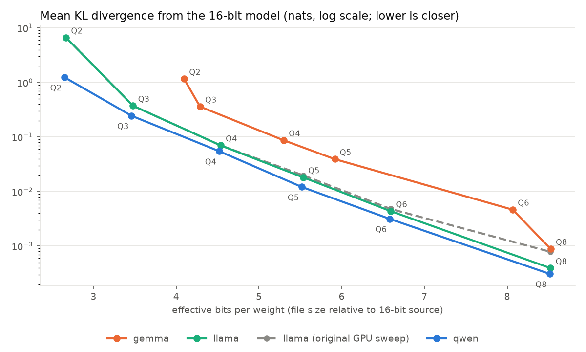
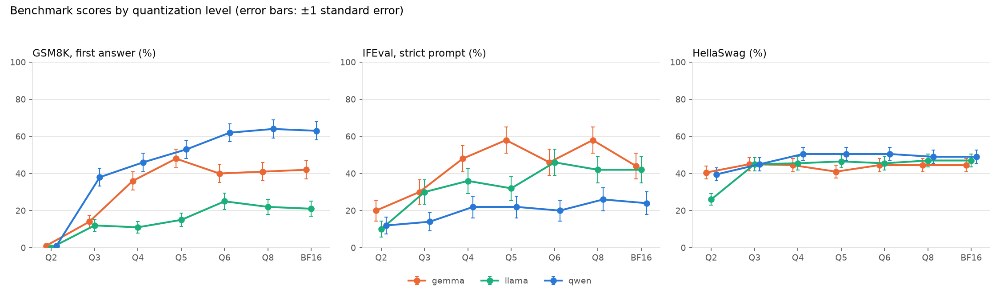
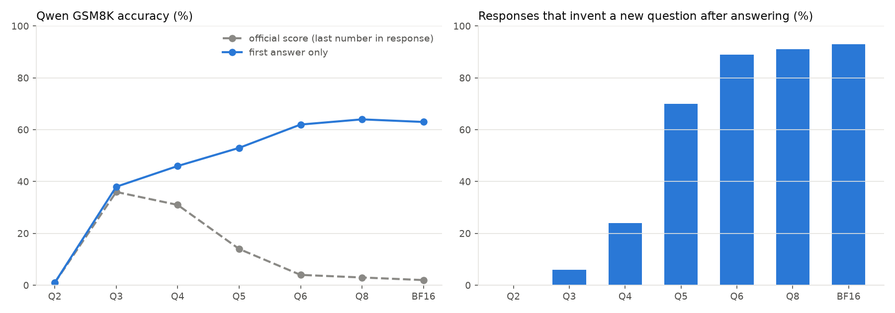
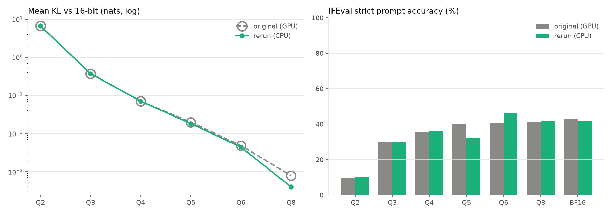
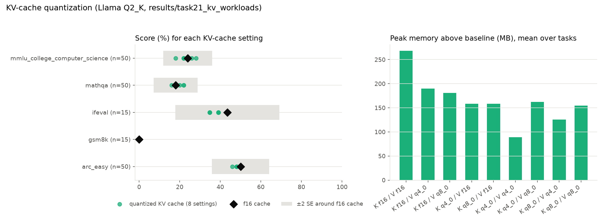

# Quantization stability across model families: findings

*Status, Nov 5 2026: all three sweeps are complete (Qwen2.5-1.5B, Gemma-3-1B,
and the Llama-3.2-1B rerun), 21 runs in total. Every table and figure here
regenerates from the saved results with
`python -m rohan.report_families && python -m rohan.analyze_findings`.*

## Summary

1. **Every family follows the same curve: each extra bit per weight cuts the
   divergence from the 16-bit model by about 3–5×.** Q6 and Q8 are close to
   lossless (mean KL ≤ 0.005 nats). Q4 drifts noticeably (KL 0.05–0.09). Q2
   breaks every model.
2. **Benchmark scores hold steady down to Q4 or Q5, then fall off sharply.**
   At Q2, GSM8K falls to 0–1% for all three families. Q3 loses a large share
   of math and instruction-following ability. HellaSwag, which is scored by
   likelihood rather than generation, barely moves until Q2.
3. **Sensitivity differs by family.** At the same bits per weight, Qwen stays
   closest to its 16-bit model and Llama collapses hardest at Q2 (KL 6.7 vs
   1.2 for Qwen). Gemma isn't a like-for-like comparison: its "pure" quants
   can't use k-quant formats for 76% of its weights (finding 4).
4. **Qwen's official GSM8K score is misleading.** The 16-bit Qwen scores 2%
   officially but 63% when only its first answer is counted. After answering,
   it invents new questions, and the scorer takes the last number it writes.
   Re-scored, Qwen degrades smoothly like the others (finding 3).
5. **The results reproduce across hardware.** The Llama rerun (Intel CPU,
   100/50/200 questions) matches the original sweep (CUDA GPU,
   1000/541/2000 questions) within 0.4% on KL from Q2 to Q4. At Q5–Q8, where
   KL is tiny, the CPU rerun reads 8–50% lower. Every task score is within
   sampling error of the original.
6. **Weight quantization matters far more than KV-cache quantization.** In
   `task21_kv_workloads`, all nine K/V cache settings land within noise of the
   f16 cache. Lowering weight precision from Q4 to Q2 moves scores by 10–45
   points.

---

## What was run

| | This work (`rohan/results/`) | Original sweep (`results/Pure_Sweep/`) | KV-cache study (`results/task21_kv_workloads/`) |
|---|---|---|---|
| Models | Qwen2.5-1.5B-Instruct, Gemma-3-1B-it, Llama-3.2-1B-Instruct | Llama-3.2-1B-Instruct | Llama-3.2-1B-Instruct Q2_K (standard mixed recipe) |
| What varies | Weight precision: 16-bit, Q8, Q6, Q5, Q4, Q3, Q2 (all `--pure`) | Same | K and V cache type: f16, q8_0, q4_0 (9 combinations) |
| Tasks (questions) | GSM8K (100), IFEval (50), HellaSwag (200) | GSM8K (1000), IFEval (541), HellaSwag (2000) | ARC-Easy, MathQA, MMLU-CS (50 each); GSM8K, IFEval (15 each) |
| Also measured | KL divergence from 16-bit on chat, math and code text | Same | Memory and speed |
| Hardware | Intel i5 MacBook, CPU only | Windows, CUDA GPU | CPU |

All runs use zero-shot prompts, no chat template, greedy decoding, and the
same leading question IDs, so this work's questions are a subset of the
original sweep's. **Standard errors at these sample sizes:** about ±5 points on
GSM8K, ±7 on IFEval, and ±3.5 on HellaSwag. Differences smaller than about
two standard errors (10 / 14 / 7 points) shouldn't be read as real.

Each family's folder also contains the same outputs as `results/Pure_Sweep/`:
`summary.csv`, `summary.png`, `kl_summary.png`, `size_quality.png` and
`stability.csv`.

---

## Finding 1: KL divergence falls steadily as bits increase

KL measures how far the quantized model's next-token probabilities are from
the 16-bit model's, averaged over held-out chat, math and code text. It's the
most precise measurement here: thousands of tokens, with uncertainty far
smaller than the gaps between levels.

| Mean KL (nats) | Qwen | Gemma | Llama rerun | Llama original |
|---|---|---|---|---|
| Q2 | 1.25 | 1.16 | **6.67** | 6.70 |
| Q3 | 0.245 | 0.361 | 0.374 | 0.374 |
| Q4 | 0.055 | 0.087 | 0.070 | 0.070 |
| Q5 | 0.012 | 0.039 | 0.018 | 0.020 |
| Q6 | 0.003 | 0.005 | 0.004 | 0.005 |
| Q8 | 0.0003 | 0.0009 | 0.0004 | 0.0008 |

- **Same slope for all three.** On a log scale, all three families fall in
  near-parallel lines, about 3–5× less KL per extra bit.
- **Qwen is consistently the most robust,** with the lowest KL at every bit
  width (subject to the vocabulary caveat at the end). Llama's Q2 is an
  outlier: 5× worse than Qwen's Q2 at the same 2.7 bits per weight. From Q3
  up, Llama tracks Qwen closely, at about 1.3–1.5× Qwen's KL.
- **The x-axis uses actual bits per weight, not labels.** "Q2" means 2.7 bits
  for Llama and Qwen but 4.1 bits for Gemma (finding 4).

## Finding 2: Scores hold through Q4–Q5, with a cliff at Q2

| Score (%) | Qwen GSM8K† / IFEval / HellaSwag | Gemma | Llama rerun | Llama original |
|---|---|---|---|---|
| 16-bit | 63 / 24 / 49 | 42 / 44 / 45 | 21 / 42 / 47 | 20 / 43 / 43 |
| Q8 | 64 / 26 / 49 | 41 / 58 / 45 | 22 / 42 / 47 | 18 / 41 / 43 |
| Q6 | 62 / 20 / 51 | 40 / 46 / 45 | 25 / 46 / 46 | 21 / 41 / 43 |
| Q5 | 53 / 22 / 51 | 48 / 58 / 41 | 15 / 32 / 47 | 17 / 40 / 43 |
| Q4 | 46 / 22 / 51 | 36 / 48 / 45 | 11 / 36 / 46 | 16 / 36 / 42 |
| Q3 | 38 / 14 / 45 | 14 / 30 / 45 | 12 / 30 / 45 | 7 / 30 / 41 |
| Q2 | 1 / 12 / 40 | 1 / 20 / 41 | 0 / 10 / 26 | 0 / 9 / 28 |

† Qwen GSM8K is first-answer accuracy (finding 3). The official scores are in
`summary_table.csv`.

- **Q6 and Q8 match the 16-bit model** within noise on every task and family.
  Gemma's 58% IFEval at Q5 and Q8 is +14 points, which is exactly 2 standard
  errors on 50 questions, so it's most likely noise rather than a real gain.
- **Q4 is where losses start for math.** Qwen GSM8K drops 17 points (63→46),
  the Llama rerun drops 10 (21→11), and Llama in the large original sweep
  drops about 4 (20→16). Instruction-following holds up at Q4.
- **Llama's Q5 dips** below its Q4 on IFEval (32 vs 36), and on both GSM8K
  and IFEval it sits below 16-bit (15 vs 21, 32 vs 42). That's about 1.5
  standard errors, so it's probably noise. The original sweep shows only a
  slight dip (17 / 40). With 100 and 50 questions, single levels can wobble
  like this. Read the overall trend rather than adjacent pairs.
- **Q3 is a sharp step down,** and **Q2 is unusable**: GSM8K is near 0 for
  every family.
- **HellaSwag barely changes.** It picks the most likely ending instead of
  generating text, so it is flat from 16-bit down to Q3. At Q2 it drops
  modestly for Qwen (49→40) and Gemma (45→41) and collapses only for Llama
  (47→26). Benchmarks scored by likelihood hide quantization damage that
  generation-based tasks expose.

**Correctness flips** (`stability.csv` in each family folder) back this up.
For generation tasks, even Q8 changes some answers relative to the 16-bit
model. At Q8, Gemma had 10 GSM8K questions go from right to wrong and 9 from
wrong to right, and Llama had 5 and 6. With greedy decoding, a tiny change in
probability can send a long answer down a different path. HellaSwag at Q8
had **0 flips in all three families**.

## Finding 3: Qwen's official GSM8K score measures run-on text, not math

- **What happens.** With a plain prompt, Qwen answers correctly ("…The answer
  is 3.") and then keeps writing its own `[Question] … [Answer]` pairs. The
  task's stop sequence is `Question:` with a colon, so it never triggers. The
  scorer takes the **last** number in the response, which comes from a
  question Qwen made up.
- **Why quantization seems to help.** Heavier quantization happens to make
  Qwen stop after one answer. 93% of 16-bit responses run on, against 6% at
  Q3, so the official score *rises* from 2% to 36% as quality falls.
- **Fix.** We re-scored the saved responses offline using only the text
  before the first invented question, with the same extraction rule as
  lm-eval. Our re-implementation reproduces the official score exactly on all
  21 runs before the cut. Gemma and Llama never invent questions, so their
  scores are unchanged.
- **IFEval is also affected, but evenly.** Qwen often continues writing the
  instruction instead of answering it, at every quantization level. That
  lowers its overall IFEval score (24%) but doesn't distort the trend across
  levels. A chat template would likely fix both problems. That would be a
  methodology change, so it's left as a follow-up.

## Finding 4: Gemma's "pure" quants are mostly a different format

Gemma-3-1B's hidden width is 1152, which isn't a multiple of 256, and k-quant
formats (Q2_K–Q6_K) need rows that are. llama.cpp falls back to older formats
for every tensor with that width, which is 76% of the weights:

| Label | Gemma's actual contents | Bits per weight | Qwen / Llama contents |
|---|---|---|---|
| Q2_K | 76% Q4_0, 24% Q2_K | 4.1 | 100% Q2_K (2.7 bits) |
| Q3_K_M | 76% Q4_0, 24% Q3_K | 4.3 | 100% Q3_K (3.5 bits) |
| Q4_K_M | 76% Q5_0, 24% Q4_K | 5.3 | 100% Q4_K (4.5 bits) |
| Q6_K | 76% Q8_0, 24% Q6_K | 8.1 | 100% Q6_K (6.6 bits) |

So "Gemma Q2" really means 4-bit weights plus a few 2-bit tensors. Even so, its
KL at 4.1 bits (1.16) is far worse than Qwen or Llama at 4.5 bits (≈0.06):

- **The small 2-bit share does disproportionate damage,** which shows how
  sensitive particular tensors are.
- **Q4_0 is less accurate per bit than Q4_K.**

Compare Gemma by bits per weight (finding 1), not by label.

## Finding 5: The Llama rerun reproduces the original sweep

**KL: near-identical where quantization error is large, slightly lower on the
CPU where it's tiny.**

| Mean KL (nats) | Q2 | Q3 | Q4 | Q5 | Q6 | Q8 |
|---|---|---|---|---|---|---|
| Original (GPU) | 6.697 | 0.374 | 0.0700 | 0.0199 | 0.0048 | 0.0008 |
| Rerun (CPU) | 6.672 | 0.374 | 0.0701 | 0.0182 | 0.0044 | 0.0004 |
| Difference | −0.4% | −0.1% | +0.1% | −8% | −9% | −50% |

From Q2 to Q4, the runs agree within 0.4% despite different hardware,
backends and sample sizes. From Q5 up, the CPU rerun reads lower. One likely
explanation, which we didn't isolate, is small rounding differences between
the CUDA and CPU backends. Those are negligible next to Q2–Q4 error but make up
a visible share of the very small Q5–Q8 KL. Either way, the ordering and
slope are the same, and every value from Q5 up is close to lossless in both
runs.

**Task scores: every gap is within sampling error.**

| Task | Largest gap | Where | Two standard errors at this sample size |
|---|---|---|---|
| GSM8K | 5 points | Q3, Q4 | 6–7 points |
| IFEval | 8 points | Q5 | 13–14 points |
| HellaSwag | 4 points | Q3, Q4 | 7 points |

HellaSwag shows one systematic difference: the rerun scores **2–4 points
higher at every level except Q2**. A constant offset across all levels points
to the question subset (the rerun uses the first 200 of the original's 2000
questions) rather than to the hardware.

Two conclusions follow:

- **The CPU pipeline is trustworthy.** Comparing Qwen and Gemma against the
  original Llama sweep is valid.
- **The smaller samples recover the same trend,** at the cost of wider error
  bars. Compare families on the same question subset, which is why the rerun
  exists.

## Comparison with the KV-cache study (`task21_kv_workloads`)

The KV-cache study kept the weights fixed at Llama Q2_K and quantized only the
attention cache. For K and V, it tried every combination of f16, q8_0 and
q4_0.

- **Quality is unaffected within measurement error.** All eight quantized
  cache settings fall inside ±2 standard errors of the f16 cache on every
  task. ARC-Easy ranges 46–50%, MathQA 16–22% and MMLU-CS 18–28%. GSM8K is 0%
  for all nine settings.
- **Weight quantization is the bigger lever.** Moving Llama's weights from Q4
  to Q2 costs 11–26 points on GSM8K and IFEval. Changing only the cache moves
  scores less than sampling noise.
- **Memory savings are real but small at this scale.** Peak memory above
  baseline falls from about 270 MB (f16/f16) to about 90 MB (q4_0/q4_0). For a
  1B model at 4K context, the whole f16 cache is only about 130 MB. The
  savings would matter more at long contexts or with larger models.
- **Caveat: the study may understate the cache's effect.** It ran on Q2_K
  weights that already score near the floor (GSM8K 0%), with 15–50 questions,
  so any cache effect on a healthy model would be hard to see. A useful next
  step is to repeat the cache study on a Q6 or Q8 model, where the baseline is
  intact.

## Caveats

- **Small samples.** With 100/50/200 questions, only gaps of more than about
  10/14/7 points are reliable. KL is the high-precision metric. Use it for
  fine-grained comparisons.
- **No chat template.** This matches the original sweep, but it penalizes
  Qwen on GSM8K (handled by re-scoring) and on IFEval (not handled).
- **Qwen's reference model is F16, not BF16,** because no official BF16 GGUF
  exists. F16 represents BF16 weights essentially exactly.
- **KL isn't directly comparable across families.** Vocabularies differ: Gemma
  has 262K tokens, Llama 128K and Qwen 152K. Compare each family's curve rather
  than raw values across families.

## Files

| File | Contents |
|---|---|
| `summary_table.csv` | Every family and level: size, bits per weight, tensor types, official and re-scored GSM8K, IFEval, HellaSwag, standard errors, mean KL |
| `kl_vs_bits.png` | Finding 1 |
| `task_scores.png` | Finding 2 |
| `qwen_gsm8k_artifact.png` | Finding 3 |
| `llama_reproducibility.png` | Finding 5 |
| `kv_cache_comparison.png`, `kv_cache_table.csv` | KV-cache comparison |
| `../family_comparison.{csv,png}` | Simple cross-family overview from `report_families` |
| `../<Family>_Pure_Sweep/` | Per-run metrics, KL, and the standard `src/report.py` outputs |
